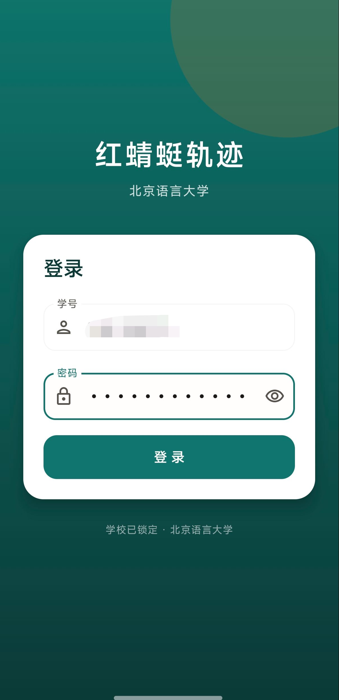
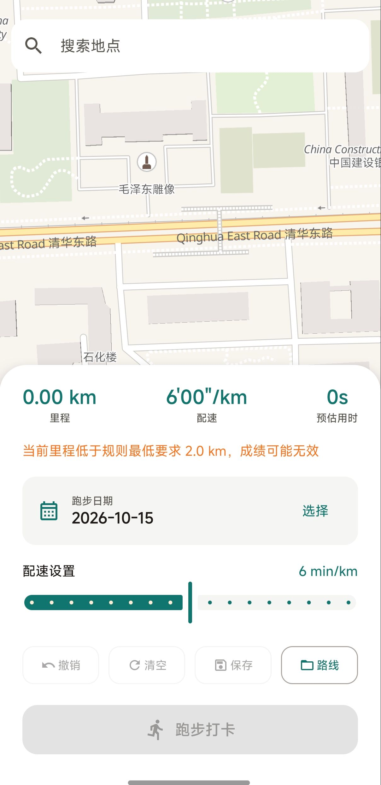
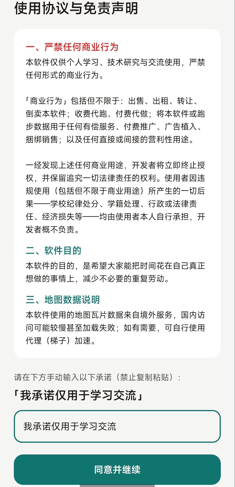

# 红蜻蜓轨迹 · Dragonfly Route

<div align="center">

**在校园地图上自由绘制跑步路线，一键生成跑步打卡。**

[](LICENSE)
[](https://www.android.com/)
[](https://kotlinlang.org/)
[](https://developer.android.com/jetpack/compose)
[](https://maplibre.org/)

</div>

---

## ⚠️ 免责声明（使用前必读）

本软件仅供**个人学习、技术研究与交流使用**。

1. **严禁任何商业行为。** 包括但不限于：出售、出租、转让、倒卖本软件；收费代跑、付费代做；将本软件或跑步数据用于任何有偿服务、付费推广、广告植入、捆绑销售；以及任何直接或间接的营利性用途。一经发现，开发者将立即终止授权，并保留追究一切法律责任的权利。
2. **使用后果自负。** 使用者因违规使用（包括但不限于商业用途）所产生的一切后果——学校纪律处分、学籍处理、行政或法律责任、经济损失等——均由使用者本人自行承担，开发者概不负责。
3. **距离仅为估算值。** 地图上绘制的路线距离为估算结果，实际跑步距离可能与显示值存在偏差，且显示距离可能小于实际距离，请以学校系统记录为准。
4. 本软件的目的，是希望大家能把时间花在自己真正想做的事情上，减少不必要的重复劳动。

> 使用本软件即表示你已阅读、理解并同意以上全部条款。

---

## ✨ 功能特性

- 🔐 **账号登录** —— 直接对接校园跑步系统，登录即获取有效令牌。
- 🗺️ **自由画线** —— 在校园地图上依次点选，实时绘制跑步轨迹。
- 🔍 **地点搜索** —— 输入关键词快速定位，免去手动拖动地图。
- 📅 **日期选择** —— 指定跑步日期。
- ⏱️ **配速设置** —— 2~10 分钟/公里自由调节。
- 💾 **路线保存** —— 保存常用路线，下次一键应用。
- 🏃 **跑步打卡** —— 一键生成打卡数据并上传。

---

## 📱 截图

| 封面 | 主界面 · 地图选点 | 协议与免责声明 |
|:---:|:---:|:---:|
|  |  |  |

---

## 🛠️ 技术栈

| 模块 | 技术 |
|---|---|
| 语言 | Kotlin |
| UI | Jetpack Compose + Material 3 |
| 地图 | MapLibre GL Native（OpenGL）+ OpenFreeMap 免费瓦片 |
| 地理编码 | OpenStreetMap Nominatim（免费，无需 key） |
| 网络 | OkHttp |
| 序列化 | kotlinx.serialization |
| 架构 | MVVM（ViewModel + StateFlow） |

> 地图与地理编码均使用**免 key 的开源服务**，克隆即可构建，无需申请任何 API key。

---

## 🚀 构建

### 环境要求

- JDK 17 或更高
- Android SDK（`compileSdk 35`）
- Android Studio（或命令行 Gradle）

### 步骤

```bash
# 克隆仓库
git clone <your-repo-url>
cd <repo>

# 配置 SDK 路径（首次）
# 编辑 local.properties，填入你的 Android SDK 路径：
# sdk.dir=C\:\\Your\\Path\\To\\Android\\Sdk

# 构建 Debug APK
./gradlew assembleDebug
```

产物位于：

```
app/build/outputs/apk/debug/app-debug.apk
```

> Windows 使用 `gradlew.bat`。

---

## 📖 使用方法

1. **首次启动**：阅读协议与免责声明，手动输入承诺语句「我承诺仅用于学习交流」后进入。
2. **登录**：输入学号与密码。
3. **绘制路线**：
   - 直接点击地图依次添加轨迹点，自动连线；
   - 或使用顶部搜索栏快速定位到目标地点。
4. **设置**：选择跑步日期、调节配速（2~10 min/km）。
5. **保存路线**：点击「保存」给当前路线命名；点击「路线」可应用或删除已保存路线。
6. **跑步打卡**：确认里程满足要求后，点击「跑步打卡」上传。

---

## 🔍 逆向文档

本项目对校园跑步系统的接口与签名算法做了逆向分析，详细技术文档见 [`doc/`](doc/)：

| 文档 | 内容 |
|---|---|
| [doc/README.md](doc/README.md) | 文档索引 |
| [01-接口与协议](doc/01-接口与协议.md) | 服务端地址、登录协议、跑步规则、上传协议 |
| [02-签名算法](doc/02-签名算法.md) | SHA256 哈希与两个 HMAC-SHA256 签名 |
| [03-数据格式](doc/03-数据格式.md) | location/datalog 格式、坐标系、防作弊线索 |
| [04-逆向方法](doc/04-逆向方法.md) | 抓包、透明代理、blutter 反编译全过程 |

---

## 📁 项目结构

```
.
├── app/
│   └── src/main/
│       ├── java/com/rahab/dragonfly/
│       │   ├── config/          # 配置（学校、接口、地图样式）
│       │   ├── data/
│       │   │   ├── api/         # 网络层（登录/上传/规则）
│       │   │   ├── model/       # 数据模型
│       │   │   └── *.kt         # 仓库层
│       │   ├── ui/
│       │   │   ├── agreement/   # 首次使用协议
│       │   │   ├── login/       # 登录
│       │   │   ├── map/         # 地图选点
│       │   │   └── theme/       # 设计系统
│       │   └── util/            # 工具（签名/坐标转换/存储）
│       └── res/                 # 资源
├── build.gradle.kts
├── settings.gradle.kts
└── gradle/wrapper/
```

---

## 📄 开源许可

本项目采用 [MIT License](LICENSE)。

© Rahab
